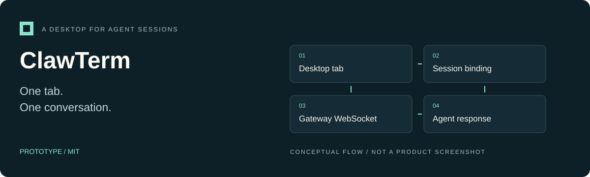

<p align="center"></p>

# ClawTerm

**A Rust desktop client that turns tabs into persistent OpenClaw agent conversations instead of shell sessions.**

Prototype · MIT · [Project overview](docs/OVERVIEW.md) · [Landing-page source](docs/site/index.html)

## What it does

ClawTerm is a Rust/egui desktop client for OpenClaw. Each tab binds to one agent session and displays a block-based conversation. The gateway owns conversation history and agent execution; ClawTerm owns the interface and tab bindings.

This is **not a PTY shell terminal**. Its terminal-inspired layout is for talking to agents.

- Live agent roster and model catalog from the gateway.
- Per-session model selection without editing gateway configuration.
- Streaming conversation updates and history reload.
- Local persistence of tab layout and session bindings.

## Run from source

Requirements: stable Rust/Cargo, the platform libraries required by eframe, a graphical desktop session, and a compatible OpenClaw gateway. There are no prebuilt installers documented here.

```sh
git clone https://github.com/ControlStackAI/clawterm.git
cd clawterm
cargo run --locked -p clawterm-app
```

By default the client reads the gateway port and `gateway.auth.token` from `~/.openclaw/openclaw.json`. For another gateway instance, supply **both** `OPENCLAW_GATEWAY_URL` and `OPENCLAW_GATEWAY_TOKEN` through your environment. Setting only one still requires that legacy config file. The client does not automatically honor an instance's state/config-path variables or resolve SecretRefs.

Never paste a real token into an issue or a committed example. Model requests use the gateway's configured account and billing.

## Use it

| Action | Control |
| --- | --- |
| New tab | `Ctrl+T` or `+` |
| Close tab | `Ctrl+W` or the close button |
| Next tab | `Ctrl+Tab` |
| Select an agent | Agent dropdown or `:agent <id-or-name>` |
| Select a model | Model dropdown or `:model <provider/model>` |
| Clear model override | `:model default` |
| Gateway command | Send `/status`, `/new`, or another supported slash command |

Switching agents creates a fresh session for that tab. Session/model bindings persist in `~/.local/share/clawterm/state.json`; conversations remain in the gateway store.

## Architecture

| Crate | Responsibility |
| --- | --- |
| `clawterm-app` | egui/eframe UI, tabs, pickers, transcript blocks, local layout state |
| `clawterm-gateway` | Gateway configuration, WebSocket RPCs, chat events, history projection |

See the [technical guide](docs/technical-guide.md) for protocol assumptions, configuration details, and the rendering/licensing boundary.

## Development and verification

```sh
cargo check --locked --workspace
cargo test --locked --workspace
```

The following smoke test uses a **real gateway** and may create a session or invoke a model. Run it only against an intended test gateway:

```sh
cargo run --locked -p clawterm-gateway --example smoke
```

**Prototype.** The source implements a particular gateway protocol and a device-less loopback handshake. Current gateway compatibility, platform packaging, and end-to-end behavior must be verified separately. This documentation does not claim that the live smoke test passed.

Contributions should include reproduction steps, OS/toolchain versions, and relevant checks. Avoid real transcripts and credentials in fixtures.

## License and attribution

[MIT](LICENSE). The UI uses egui/eframe. Warp-inspired interaction patterns do not mean the AGPL Warp application is bundled; see [THIRD_PARTY_NOTICES.md](THIRD_PARTY_NOTICES.md) for the documented boundary and attribution. This documentation refresh is not a new dependency-license audit.
